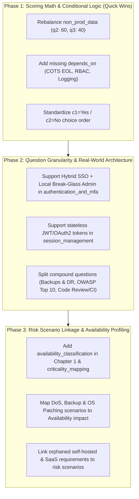

# AppSec Framework (`appsec_manual.yml` & `appsec.yml`) Questions & Risk Evaluation Improvement Plan

**Date**: November 6, 2026  
**Current Framework Versions**: `appsec_manual.yml` (v14), `appsec.yml` (v32), `appsec_objects.yml` (v2)  
**Target Framework Versions**: `appsec_manual.yml` (v12), `appsec.yml` (v13), `appsec_objects.yml` (v3)  
**Affected Files**:
- [YML/appsec_manual.yml](file:///home/romain/ciso-assistant/YML/appsec_manual.yml) *(Reference Framework)*
- [YML/appsec.yml](file:///home/romain/ciso-assistant/YML/appsec.yml) *(Dynamic IG Variant)*
- [YML/appsec_objects.yml](file:///home/romain/ciso-assistant/YML/appsec_objects.yml) *(Shared Risk Scenarios, Matrix, Threats, Vulnerabilities & Controls)*
- [docs/appsec_policy_applicability_matrix.md](file:///home/romain/ciso-assistant/docs/appsec_policy_applicability_matrix.md)
- [docs/appsec_questions_cases.md](file:///home/romain/ciso-assistant/docs/appsec_questions_cases.md)
- [test_data/app_appsec_*.yml](file:///home/romain/ciso-assistant/test_data/)
- [tests/test_yaml_integrity.py](file:///home/romain/ciso-assistant/tests/test_yaml_integrity.py)
- [tests/test_application_scenarios.py](file:///home/romain/ciso-assistant/tests/test_application_scenarios.py)

---

## 1. Executive Summary

Following the alignment of [YML/appsec_manual.yml](file:///home/romain/ciso-assistant/YML/appsec_manual.yml) and [YML/appsec.yml](file:///home/romain/ciso-assistant/YML/appsec.yml) (59 requirement nodes, 34 assessable requirements, 8 Implementation Groups, and 25 shared risk scenarios), a deep review of the **questionnaire design, conditional branching (`depends_on`), scoring mathematics, and risk scenario linkage** identified five high-impact areas for improvement:

1. **Scoring Math & Unreachable Risk Likelihoods**: Fix dead-weight question weights (such as `non_prod_data:q3` with `+10`, which can never alter risk likelihood under the `4 - ((score - 1) // 25)` formula) and eliminate binary `0 / 100` jumps that make Likelihood 2 (*Rather unlikely*) and Likelihood 3 (*Likely*) unreachable across 21 single-question requirements.
2. **Missing Conditional (`depends_on`) Branching**: Prevent moot follow-up questions from being asked when a prerequisite control is absent (e.g., asking if vendor patches are applied within 14-day SLAs when the COTS software is End-of-Life (`cots_deployment_hardening:q2 == No`)).
3. **Unlinked Requirements in Risk Evaluation**: Connect the 19 assessable requirement nodes that currently have no effect on any risk scenario in [YML/appsec_objects.yml](file:///home/romain/ciso-assistant/YML/appsec_objects.yml).
4. **Real-World Architecture & Profiling Gaps**: Account for hybrid authentication (Enterprise SSO + local break-glass admin accounts), machine-to-machine (mTLS/OAuth2) APIs, stateless token sessions, and **Application Availability / Business Criticality** profiling in Chapter 1.
5. **Compound (Double-Barreled) Questions & UX Consistency**: Split multi-control Yes/No questions (such as `backup_and_disaster_recovery:q1` and `owasp_top_10_defenses:q1`) and standardize `Yes` (`c1`) vs. `No` (`c2`) choice ordering across all nodes.

---

## 2. Phase 1: Scoring Mathematics & Conditional (`depends_on`) Fixes

### 2.1 Fix Dead-Weight Scoring in `non_prod_data` (`q2` & `q3`)
- **Current Issue**:
  - Likelihood is calculated from the requirement score (`0..100`) using:
    $$\text{Likelihood} = \min\left(4, \max\left(1, 4 - \left\lfloor\frac{\text{score} - 1}{25}\right\rfloor\right)\right)$$
    - `0–25` $\rightarrow$ **Likelihood 4** (*Very likely*)
    - `26–50` $\rightarrow$ **Likelihood 3** (*Likely*)
    - `51–75` $\rightarrow$ **Likelihood 2** (*Rather unlikely*)
    - `76–100` $\rightarrow$ **Likelihood 1** (*Unlikely*)
  - In `non_prod_data`, when production data is used in non-production (`q1 = Yes, +0`):
    - `q2` (*"How do you protect them?"*) awards **`+90`** for Hashing, Pseudonymisation, Encryption, or Masking.
    - `q3` (*"Do you clean the prod data after use in non-prod?"*) awards **`+10`** for `"Yes"`.
  - **Mathematical Defect**: `q3` (`+10`) **can never change the computed likelihood**:
    - `q2 = No protection (0)` + `q3 = No (0)` = `0` (**L4**) vs. `q2 = No protection (0)` + `q3 = Yes (10)` = `10` (**still L4**).
    - `q2 = Masked (90)` + `q3 = No (0)` = `90` (**L1**) vs. `q2 = Masked (90)` + `q3 = Yes (10)` = `100` (**still L1**).
- **Planned Fix**:
  - Change `non_prod_data:q2` protective choices (`c2`–`c5`) from `add_score: 90` to **`add_score: 60`**.
  - Change `non_prod_data:q3` (`"Yes"`) from `add_score: 10` to **`add_score: 40`**.
  - **New Behavior**:
    - Sanitized + Purged (`60 + 40 = 100`) $\rightarrow$ **Likelihood 1**
    - Sanitized but Retained indefinitely (`60 + 0 = 60`) $\rightarrow$ **Likelihood 2**
    - Unsanitized but Purged after test (`0 + 40 = 40`) $\rightarrow$ **Likelihood 3**
    - Unsanitized and Retained (`0 + 0 = 0`) $\rightarrow$ **Likelihood 4**

### 2.2 Fix `stakeholder_identification` Bucket Boundary
- **Current Issue**:
  - `stakeholder_identification` has 4 questions (`q1`–`q4`), each worth `25` points.
  - Because `score = 25` falls into the `1–25` bucket (`(25 - 1) // 25 = 0`), having 1 designated stakeholder (`25` pts) yields **Likelihood 4**, identical to having 0 stakeholders (`0` pts).
- **Planned Fix**:
  - Weight the core operational owners slightly higher (`q1` Business Contact: `30`, `q2` IT Contact: `30`, `q3` Data Owner: `25`, `q4` CMDB/Inventory Update: `15`) so that having at least one primary owner (`30` pts) moves likelihood from **L4** to **L3**, having two owners (`55–60` pts) moves to **L2**, and full governance (`85–100` pts) achieves **L1**.

### 2.3 Add Missing `depends_on` Conditions
Several follow-up questions are currently displayed even when the parent answer renders them moot:

1. **`cots_deployment_hardening:q3` (Vendor Patch Deployment SLAs)**:
   - *Current*: Asked even when `q2` (*"Does the COTS software actively receive security patches... not EOL/EOS?"*) is `"No"`. If software is End-of-Life and receives no patches from the vendor, asking if published vendor patches are deployed within 14 days is contradictory.
   - *Fix*: Add `depends_on: cots_deployment_hardening:q2 == c1 ("Yes")` on `q3`.
2. **`access_control_and_rbac:q2` & `q3` (IGA Integration & Role Recertification)**:
   - *Current*: Asked even when `q1` (*"Have you defined roles and permissions for the application?"*) is `"No"`.
   - *Fix*: Add `depends_on: access_control_and_rbac:q1 == c1 ("Yes")` on both `q2` and `q3`.
3. **`security_event_logging:q2` (Log Sanitization / Masking)**:
   - *Current*: Asked even when `q1` (*"Does the application log key security events?"*) is `"No"`.
   - *Fix*: Add `depends_on: security_event_logging:q1 == c1 ("Yes")` on `q2` (or rephrase `q2` to cover application error/diagnostic logs as well).

### 2.4 Standardize `Yes` / `No` Choice Ordering
- **Current Issue**:
  - In 95% of questions across the framework, `c1` is `"Yes"` (`#33a745`) and `c2` is `"No"` (`#dc3545`).
  - However, in **`non_prod_data:q3`** and **`data_destruction:q1` & `q2`**, the order is inverted (`c1` is `"No"`, `c2` is `"Yes"`).
- **Planned Fix**:
  - Standardize `c1 = "Yes"` and `c2 = "No"` across `non_prod_data:q3`, `data_destruction:q1`, and `data_destruction:q2` (updating `depends_on` choice URNs accordingly).

---

## 3. Phase 2: Real-World Architecture & Question Granularity

### 3.1 Hybrid Authentication & Break-Glass Admin Accounts (`authentication_and_mfa`)
- **Current Issue**:
  - `authentication_and_mfa:q1` forces a strict binary choice:
    - `c1`: `"Enterprise SSO (SAML 2.0 / OIDC federated IdP)"` (`+100`, skips `q2` and `q3`)
    - `c2`: `"Direct / Local application authentication (Username & Password)"` (`+0`, triggers `q2` and `q3`)
  - **Gap 1 (Hybrid SSO + Local Admin/Break-Glass)**: Most enterprise applications integrated with SSO still maintain local administrator or break-glass accounts. Selecting `c1` awards `100` immediately without verifying whether local admin/break-glass accounts enforce strong passwords and MFA (whereas `saas_iam:q1` explicitly checks break-glass/admin MFA).
  - **Gap 2 (Machine-to-Machine / Public Apps)**: Microservices or APIs without human login (using mTLS or OAuth2 Client Credentials) and unauthenticated public portals have no accurate choice in `q1`.
- **Planned Fix**:
  - Update `authentication_and_mfa:q1` choices:
    - `c1`: `"Enterprise SSO exclusively (SAML 2.0 / OIDC federated IdP, with no local accounts)"` (`+100`)
    - `c2`: `"Hybrid: Enterprise SSO for users, with local admin / break-glass or external accounts"` (`+40`, triggers `q2` (`+30`) and `q3` (`+30`))
    - `c3`: `"Direct / Local application authentication only (Username & Password)"` (`+0`, triggers `q2` (`+30`) and `q3` (`+30`), max score `60` = Likelihood 2 because Enterprise SSO is not used)
    - `c4`: `"Machine-to-Machine / API only (mTLS, OAuth2 Client Credentials, or signed tokens; no interactive user login)"` (`+100`)

### 3.2 Support Stateless Token Architectures in `session_management`
- **Current Issue**:
  - `session_management:q1` asks: *"Are session tokens cryptographically secure, transmitted with secure cookie flags (HttpOnly, Secure, SameSite), and invalidated on logout or inactivity?"*
  - Pure REST/GraphQL APIs and mobile backends using short-lived OAuth2/OIDC Bearer tokens (`Authorization: Bearer`) do not use browser cookies.
- **Planned Fix**:
  - Split `session_management` into 2 questions or expand wording to cover both cookie-based sessions (`HttpOnly`, `Secure`, `SameSite`) and token-based APIs (cryptographically signed short-lived JWT/opaque tokens with strict expiration and revocation/refresh rotation).

### 3.3 Split Compound (Double-Barreled) `100`-Point Questions
Single Yes/No questions worth `100` points that bundle multiple independent controls force respondents into an all-or-nothing answer and prevent intermediate likelihoods (L2/L3):

| Requirement Node | Current Single Question (`100` pts) | Proposed Split (`50` + `50` pts or 3-Tier Maturity) |
| :--- | :--- | :--- |
| **[`backup_and_disaster_recovery`](file:///home/romain/ciso-assistant/YML/appsec_manual.yml#L1467-L1499)** | Bundles automated encrypted backups **and** annual restoration testing (unlike `saas_backup_and_business_continuity`, which splits them). | **`q1` (`+50`)**: Are automated and encrypted backups maintained for application state and databases? **`q2` (`+50`, `depends_on: q1 == Yes`)**: Are backup restoration and disaster recovery drills tested at least annually against documented RTO/RPO targets? |
| **[`owasp_top_10_defenses`](file:///home/romain/ciso-assistant/YML/appsec_manual.yml#L651-L686)** | Bundles input validation, parameterized queries, output encoding, and error handling into 1 question. | **`q1` (`+50`)**: Are server-side input validation and parameterized queries/ORMs enforced to prevent injection flaws (SQLi, command injection, SSRF)? **`q2` (`+50`)**: Are context-aware output encoding, security headers (CSP), and generic production error handlers enforced to prevent XSS and stack-trace leakage? |
| **[`code_review_and_ci_cd_integrity`](file:///home/romain/ciso-assistant/YML/appsec_manual.yml#L993-L1026)** | Bundles peer code review and repository branch protection rules. | **`q1` (`+50`)**: Are mandatory peer code reviews enforced prior to merging changes? **`q2` (`+50`)**: Do repository branch protection rules block direct commits, force-pushes, and failing CI status checks on deployment branches? |
| **[`api_security_and_rate_limiting`](file:///home/romain/ciso-assistant/YML/appsec_manual.yml#L1077-L1109)** | Bundles Edge WAF/bot protection and application/API rate limiting. | **`q1` (`+50`)**: Are internet-facing endpoints fronted by an Edge WAF and anti-DDoS / bot protection? **`q2` (`+50`)**: Are API rate limiting, throttling, and payload size quotas enforced to prevent scraping and resource exhaustion? |

---

## 4. Phase 3: Risk Scenario Linkage & Multi-Dimensional Impact

### 4.1 Add Availability / Business Criticality Profiling in Chapter 1
- **Current Issue**:
  - In [YML/appsec_manual.yml](file:///home/romain/ciso-assistant/YML/appsec_manual.yml#L2703-L2710), `criticality_mapping` only maps `confidentiality` (`data_classification:q1`), leaving `availability: {}` and `integrity: {}` empty.
  - Consequently, pure availability and business continuity scenarios — **Scenario 13** (*API abuse and denial of service*), **Scenario 15** (*Catastrophic data loss due to unverified backups*), and **Scenario 21** (*Host or OS compromise via unpatched system vulnerabilities*) — derive their impact solely from data confidentiality. A mission-critical public storefront or routing service processing `Public` data receives **Impact = 1 (Minor)** for a catastrophic outage.
- **Planned Fix**:
  1. Add `availability_classification` (`ref_id: availability_classification`, `implementation_groups: ["info"]`) under Chapter 1 (`info`) with 4 RTO/MTD tiers (`Low / Non-Critical`, `Medium`, `High`, `Critical / Mission-Critical`).
  2. Populate `criticality_mapping.availability` and set `test_metadata.availability_node_ref: "availability_classification"`.
  3. Point the `impact` of availability-driven scenarios (`prolonged_outage_data_loss`, `api_abuse_and_denial_of_service`, and optionally `saas_backup_and_business_continuity`) to `availability_classification`.

### 4.2 Connect Unlinked Requirements to Risk Scenarios
Currently, **19 out of 34 assessable requirements** are not referenced by any risk scenario's `likelihood` in [YML/appsec_objects.yml](file:///home/romain/ciso-assistant/YML/appsec_objects.yml):

| Track | Unlinked Requirement Node(s) | Recommended Risk Scenario Linkage |
| :--- | :--- | :--- |
| **`custom_app`** | `session_management` | Link to a dedicated scenario (*Session hijacking and token replay*) or combine into Scenario 8 (`account_takeover_via_weak_auth`). |
| **`custom_app` / `cots_app`** | `automated_security_testing`, `code_review_and_ci_cd_integrity`, `vendor_secure_development` | Link to a dedicated SDLC scenario (*Deployment of undetected code vulnerabilities due to missing SDLC security gates*). |
| **`infra`** | `security_event_logging` | Link to a dedicated scenario (*Sensitive data exposure in logs or missing forensic audit trail*) alongside Scenario 14 (`centralized_monitoring_and_alerting`). |
| **`saas_app`** | `saas_data_hosting_and_residency` | Link to a dedicated GDPR/Residency scenario (*Unlawful cross-border data transfer and residency non-compliance*) so certified SaaS apps are evaluated on residency (currently Scenario 18 only checks `saas_environment_isolation` in `saas_uncertified`). |
| **`saas_app`** | `saas_pci_dss` | Link to a conditional PCI scenario (*Non-compliant cardholder data processing in SaaS environment*) when `saas_pci_dss:q1 == Yes`. |
| **`saas_uncertified`** | `saas_logging_and_incidents`, `saas_backup_and_business_continuity`, `saas_subcontractor_management`, `saas_secure_development`, `saas_web_app_security`, `saas_network_security`, `saas_workstation_security`, `saas_mobile_security`, `saas_governance_and_policy`, `saas_security_awareness`, `saas_physical_security` | Map key operational SaaS controls (`saas_logging_and_incidents`, `saas_backup_and_business_continuity`, `saas_subcontractor_management`) to corresponding SaaS risk scenarios so uncertified vendor gaps directly drive risk levels. |

---

## 5. Implementation Checklist & Verification Plan

- [x] **Step 1 (Phase 1 — Scoring & `depends_on`) [COMPLETED]**:
  - Update `non_prod_data` (`q2: 60`, `q3: 40`), `stakeholder_identification` weights, `cots_deployment_hardening:q3` `depends_on`, `access_control_and_rbac:q3` `depends_on`, and `security_event_logging:q2` rephrasing in both [YML/appsec_manual.yml](file:///home/romain/ciso-assistant/YML/appsec_manual.yml) and [YML/appsec.yml](file:///home/romain/ciso-assistant/YML/appsec.yml).
  - Standardize `c1 = "Yes"` / `c2 = "No"` choice order in `non_prod_data:q3` and `data_destruction:q1`/`q2`.
- [x] **Step 2 (Phase 2 — Question Granularity & Hybrid Auth) [COMPLETED]**:
  - Expand `authentication_and_mfa:q1` choices for hybrid SSO + local break-glass (`+40`) and machine-to-machine APIs (`+100`), re-weighting `q2` and `q3` to `+30` / `+30`.
  - Support stateless token architectures in `session_management:q1` (session identifiers and API bearer tokens).
  - Split compound questions into two 50+50 point questions in `backup_and_disaster_recovery` (`q2` depends on `q1:c1`), `owasp_top_10_defenses`, `code_review_and_ci_cd_integrity`, and `api_security_and_rate_limiting`.
  - Synchronize all 15 application profiles in `test_data/` and verify 100% automated test suite passing.
- [ ] **Step 3 (Phase 3 — Availability & Risk Scenario Linkage)**:
  - Add `availability_classification` to Chapter 1 and `criticality_mapping.availability` (Phase 3 Point 1).
  - [x] **Add/link risk scenarios in [YML/appsec_objects.yml](file:///home/python/ciso-assistant/YML/appsec_objects.yml) for unlinked requirements and update `test_metadata` (Phase 3 Point 2) [COMPLETED]**:
    - Created 19 new risk scenarios (scenarios 26 through 44) linking all previously unlinked assessable requirements: `session_management`, `code_review_and_ci_cd_integrity`, `automated_security_testing`, `vendor_secure_development`, `security_event_logging`, `saas_data_hosting_and_residency`, `saas_pci_dss`, `saas_non_conformity_remediation`, and all 11 `saas_uncertified` operational nodes (`saas_logging_and_incidents`, `saas_backup_and_business_continuity`, `saas_subcontractor_management`, `saas_secure_development`, `saas_web_app_security`, `saas_network_security`, `saas_workstation_security`, `saas_mobile_security`, `saas_governance_and_policy`, `saas_security_awareness`, `saas_physical_security`).
    - Achieved 100% risk scenario coverage: exactly 44 assessable security requirements mapped 1-to-1 to 44 risk scenarios with zero orphaned requirements, reference controls, or vulnerabilities.
    - Updated `expected_risk_scenarios_count: 44` in `test_metadata` for `appsec` (v34) and `appsec_manual` (v16).
    - Synchronized all 15 application profiles in [test_data/](file:///home/python/ciso-assistant/test_data/) with verified scenario counts, scaled likelihoods, impacts, and matrix risk IDs.
    - Added unit test `test_appsec_phase3_unlinked_requirements_risk_scenario_coverage` in [tests/test_yaml_integrity.py](file:///home/python/ciso-assistant/tests/test_yaml_integrity.py).
    - Verified 100% pass across all 280 tests (`python3 -m unittest discover tests`).
- [ ] **Step 4 (Sync Docs, Examples & Tests)**:
  - Update [docs/appsec_questions_cases.md](file:///home/romain/ciso-assistant/docs/appsec_questions_cases.md) and [docs/appsec_policy_applicability_matrix.md](file:///home/romain/ciso-assistant/docs/appsec_policy_applicability_matrix.md).
  - Update [test_data/app_appsec_*.yml](file:///home/romain/ciso-assistant/test_data/) and run `python3 -m unittest discover tests` to verify 100% test pass.
