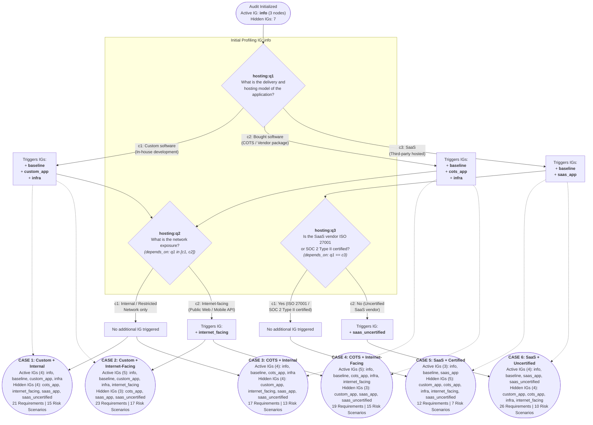

# Conditional Implementation Group (IG) Graph & Application Example Suite — `appsec_manual.yml`

This document details the complete conditional Implementation Group (IG) state machine, intra-node question dependencies (`depends_on`), requirement scoping, and risk scenario scoping for **`YML/appsec_manual.yml`** (`ref_id: "appsec_manual"`, **Application Security Assessment Framework (AppSec - Manual IG)**).

---

## 1. Implementation Groups Overview (8 Total)

| IG `ref_id` | IG Name | `default_selected` | Activation Mode | Assessable Nodes |
| :--- | :--- | :---: | :--- | :---: |
| `info` | **Application information & Governance** | `true` | Always active initially (`always_selectable_groups`) | **3** |
| `baseline` | **Application Security Baseline** | `false` | Triggered by `hosting:q1` $\in \{c_1, c_2, c_3\}$ | **2** |
| `custom_app` | **Custom Software Track (In-house Development)** | `false` | Triggered by `hosting:q1` $= c_1$ | **9** *(6 exclusive + 3 shared with `cots_app`)* |
| `cots_app` | **Bought Software Track (COTS / Vendor Package)** | `false` | Triggered by `hosting:q1` $= c_2$ | **5** *(2 exclusive + 3 shared with `custom_app`)* |
| `infra` | **Infrastructure & Hosting Security Track** | `false` | Triggered by `hosting:q1` $\in \{c_1, c_2\}$ | **7** |
| `internet_facing` | **Internet-Facing Application Track** | `false` | Triggered by `hosting:q2` $= c_2$ (when `hosting:q1` $\in \{c_1, c_2\}$) | **2** |
| `saas_app` | **SaaS Application Track** | `false` | Triggered by `hosting:q1` $= c_3$ | **7** |
| `saas_uncertified` | **Uncertified SaaS Vendor Track (Detailed Security Assessment)** | `false` | Triggered by `hosting:q3` $= c_2$ (when `hosting:q1` $= c_3$) | **14** |

> [!NOTE]
> Three requirement nodes (`data_exchange`, `non_prod_data`, and `data_destruction`) belong to both `custom_app` and `cots_app` (`implementation_groups: ["custom_app", "cots_app"]`). Therefore, the total number of distinct assessable requirement nodes across all 8 Implementation Groups is $3 + 2 + 6 + 2 + 3 + 7 + 2 + 7 + 14 = 46$.

---

## 2. Conditional IG Decision & Dependency Graph

All 10 `implementation_groups_dependencies` rules originate from the **`hosting`** requirement node (`urn:intuitem:risk:req_node:appsec_manual:hosting`) inside the initial **`info`** Implementation Group:

---

## 3. All 10 `implementation_groups_dependencies` Rules

| # | Dependency `ref_id` | Source IG | Trigger Question | Trigger Choice | Target IG (`target_implementation_group`) |
| :---: | :--- | :--- | :--- | :--- | :--- |
| **1** | `dep_custom_app` | `info` | `hosting:q1` | `c1` (*Custom software...*) | `custom_app` |
| **2** | `dep_custom_infra` | `info` | `hosting:q1` | `c1` (*Custom software...*) | `infra` |
| **3** | `dep_custom_baseline` | `info` | `hosting:q1` | `c1` (*Custom software...*) | `baseline` |
| **4** | `dep_cots_app` | `info` | `hosting:q1` | `c2` (*Bought software...*) | `cots_app` |
| **5** | `dep_cots_infra` | `info` | `hosting:q1` | `c2` (*Bought software...*) | `infra` |
| **6** | `dep_cots_baseline` | `info` | `hosting:q1` | `c2` (*Bought software...*) | `baseline` |
| **7** | `dep_saas_app` | `info` | `hosting:q1` | `c3` (*SaaS...*) | `saas_app` |
| **8** | `dep_saas_baseline` | `info` | `hosting:q1` | `c3` (*SaaS...*) | `baseline` |
| **9** | `dep_saas_uncertified` | `info` | `hosting:q3` | `c2` (*No - Not certified*) | `saas_uncertified` |
| **10** | `dep_internet_facing` | `info` | `hosting:q2` | `c2` (*Internet-facing...*) | `internet_facing` |

---

## 4. Exhaustive Matrix of the 6 Conditional IG Combinations & Example Profiles

| Case | Example Profile (`test_data/*.yml`) | `hosting:q1` | `hosting:q2` | `hosting:q3` | Active IGs (`visible_groups`) | Hidden IGs (`hidden_groups`) | Scoped Reqs | Scoped Scenarios | Classification |
| :---: | :--- | :--- | :--- | :--- | :--- | :--- | :---: | :---: | :--- |
| **0** | *(Initial Audit State)* | *(Unanswered)* | *(Hidden)* | *(Hidden)* | `info` (1) | `baseline`, `custom_app`, `cots_app`, `infra`, `saas_app`, `saas_uncertified`, `internet_facing` (7) | **3** | **0** | N/A |
| **1** | `app_manual_custom_internal.yml` | `c1` (Custom) | `c1` (Internal) | *(Hidden)* | `info`, `baseline`, `custom_app`, `infra` (4) | `cots_app`, `internet_facing`, `saas_app`, `saas_uncertified` (4) | **21** | **15** | `Internal` |
| **2** | `app_manual_custom_internet.yml` | `c1` (Custom) | `c2` (Internet) | *(Hidden)* | `info`, `baseline`, `custom_app`, `infra`, `internet_facing` (5) | `cots_app`, `saas_app`, `saas_uncertified` (3) | **23** | **17** | `Secret` |
| **3** | `app_manual_cots_internal.yml` | `c2` (COTS) | `c1` (Internal) | *(Hidden)* | `info`, `baseline`, `cots_app`, `infra` (4) | `custom_app`, `internet_facing`, `saas_app`, `saas_uncertified` (4) | **17** | **13** | `Confidential` |
| **4** | `app_manual_cots_internet.yml` | `c2` (COTS) | `c2` (Internet) | *(Hidden)* | `info`, `baseline`, `cots_app`, `infra`, `internet_facing` (5) | `custom_app`, `saas_app`, `saas_uncertified` (3) | **19** | **15** | `Confidential` |
| **5** | `app_manual_saas_certified.yml` | `c3` (SaaS) | *(Hidden)* | `c1` (Yes) | `info`, `baseline`, `saas_app` (3) | `custom_app`, `cots_app`, `infra`, `internet_facing`, `saas_uncertified` (5) | **12** | **7** | `Confidential` |
| **6** | `app_manual_saas_uncertified.yml` | `c3` (SaaS) | *(Hidden)* | `c2` (No) | `info`, `baseline`, `saas_app`, `saas_uncertified` (4) | `custom_app`, `cots_app`, `infra`, `internet_facing` (4) | **26** | **10** | `Secret` |

---

## 5. Intra-Node Question Dependencies (`depends_on`) Coverage Across the 6 Examples

In addition to framework-level IG dependencies, `appsec_manual.yml` contains **8 requirement nodes with intra-node conditional questions (`depends_on`)**. The 6 application examples are designed so that **both the skipped ("No/SSO/Automatic") and triggered ("Yes/Direct/Manual") branches of every conditional question are tested**:

```mermaid
flowchart LR
    subgraph IntraNode ["Intra-Node Conditional Question Branches (depends_on)"]
        direction TB
        A["<b>authentication_and_mfa:q1</b><br/>c1 (Enterprise SSO) &#8594; skips q2, q3 <i>[Cases 1, 3, 5]</i><br/>c2 (Direct Auth) &#8594; unlocks q2, q3 <i>[Cases 2, 4, 6]</i>"]
        B["<b>file_upload_security:q1</b><br/>c1 (No uploads) &#8594; skips q2, q3 <i>[Case 1]</i><br/>c2 (Yes uploads) &#8594; unlocks q2, q3 <i>[Case 2]</i>"]
        C["<b>data_exchange:q1</b><br/>c1 (No external exchange) &#8594; skips q2 <i>[Case 1]</i><br/>c2 (Yes external exchange) &#8594; unlocks q2 <i>[Cases 2, 3, 4]</i>"]
        D["<b>non_prod_data:q1</b><br/>c1 (Synthetic/mock only) &#8594; skips q2, q3 <i>[Cases 1, 4]</i><br/>c2 (Prod data in non-prod) &#8594; unlocks q2, q3 <i>[Cases 2, 3]</i>"]
        E["<b>data_destruction:q1</b><br/>c1 (No destruction process) &#8594; skips q2 <i>[Case 2]</i><br/>c2 (Yes destruction process) &#8594; unlocks q2 <i>[Cases 1, 3, 4]</i>"]
        F["<b>os_patching:q1</b><br/>c1 (Automatic OS patching) &#8594; skips q2 <i>[Case 1]</i><br/>c2 (Manual OS patching) &#8594; unlocks q2 <i>[Cases 2, 3, 4]</i>"]
        G["<b>saas_pci_dss:q1</b><br/>c1 (Out of scope for PCI DSS) &#8594; skips q2, q3 <i>[Case 6]</i><br/>c2 (In scope for PCI DSS) &#8594; unlocks q2, q3 <i>[Case 5]</i>"]
    end
```

---

## 6. Requirement Node Applicability Matrix Across All 6 Cases (46 Assessable Nodes)

| # | Requirement `ref_id` | Implementation Group(s) | Case 1 (Custom+Int) | Case 2 (Custom+Ext) | Case 3 (COTS+Int) | Case 4 (COTS+Ext) | Case 5 (SaaS+Cert) | Case 6 (SaaS+Uncert) |
| :---: | :--- | :--- | :---: | :---: | :---: | :---: | :---: | :---: |
| 1 | `stakeholder_identification` | `info` | $\checkmark$ | $\checkmark$ | $\checkmark$ | $\checkmark$ | $\checkmark$ | $\checkmark$ |
| 2 | `data_classification` | `info` | $\checkmark$ | $\checkmark$ | $\checkmark$ | $\checkmark$ | $\checkmark$ | $\checkmark$ |
| 3 | `hosting` | `info` | $\checkmark$ | $\checkmark$ | $\checkmark$ | $\checkmark$ | $\checkmark$ | $\checkmark$ |
| 4 | `authentication_and_mfa` | `baseline` | $\checkmark$ | $\checkmark$ | $\checkmark$ | $\checkmark$ | $\checkmark$ | $\checkmark$ |
| 5 | `access_control_and_rbac` | `baseline` | $\checkmark$ | $\checkmark$ | $\checkmark$ | $\checkmark$ | $\checkmark$ | $\checkmark$ |
| 6 | `session_management` | `custom_app` | $\checkmark$ | $\checkmark$ | — | — | — | — |
| 7 | `owasp_top_10_defenses` | `custom_app` | $\checkmark$ | $\checkmark$ | — | — | — | — |
| 8 | `file_upload_security` | `custom_app` | $\checkmark$ | $\checkmark$ | — | — | — | — |
| 9 | `automated_security_testing` | `custom_app` | $\checkmark$ | $\checkmark$ | — | — | — | — |
| 10 | `supply_chain_and_dependencies` | `custom_app` | $\checkmark$ | $\checkmark$ | — | — | — | — |
| 11 | `code_review_and_ci_cd_integrity` | `custom_app` | $\checkmark$ | $\checkmark$ | — | — | — | — |
| 12 | `vendor_secure_development` | `cots_app` | — | — | $\checkmark$ | $\checkmark$ | — | — |
| 13 | `cots_deployment_hardening` | `cots_app` | — | — | $\checkmark$ | $\checkmark$ | — | — |
| 14 | `data_exchange` | `custom_app`, `cots_app` | $\checkmark$ | $\checkmark$ | $\checkmark$ | $\checkmark$ | — | — |
| 15 | `non_prod_data` | `custom_app`, `cots_app` | $\checkmark$ | $\checkmark$ | $\checkmark$ | $\checkmark$ | — | — |
| 16 | `data_destruction` | `custom_app`, `cots_app` | $\checkmark$ | $\checkmark$ | $\checkmark$ | $\checkmark$ | — | — |
| 17 | `secrets_management` | `infra` | $\checkmark$ | $\checkmark$ | $\checkmark$ | $\checkmark$ | — | — |
| 18 | `data_in_transit` | `infra` | $\checkmark$ | $\checkmark$ | $\checkmark$ | $\checkmark$ | — | — |
| 19 | `data_at_rest` | `infra` | $\checkmark$ | $\checkmark$ | $\checkmark$ | $\checkmark$ | — | — |
| 20 | `security_event_logging` | `infra` | $\checkmark$ | $\checkmark$ | $\checkmark$ | $\checkmark$ | — | — |
| 21 | `centralized_monitoring_and_alerting` | `infra` | $\checkmark$ | $\checkmark$ | $\checkmark$ | $\checkmark$ | — | — |
| 22 | `backup_and_disaster_recovery` | `infra` | $\checkmark$ | $\checkmark$ | $\checkmark$ | $\checkmark$ | — | — |
| 23 | `os_patching` | `infra` | $\checkmark$ | $\checkmark$ | $\checkmark$ | $\checkmark$ | — | — |
| 24 | `api_security_and_rate_limiting` | `internet_facing` | — | $\checkmark$ | — | $\checkmark$ | — | — |
| 25 | `penetration_testing_and_vulnerability_management` | `internet_facing` | — | $\checkmark$ | — | $\checkmark$ | — | — |
| 26 | `saas_contract_compliance` | `saas_app` | — | — | — | — | $\checkmark$ | $\checkmark$ |
| 27 | `saas_confidentiality_and_data_protection` | `saas_app` | — | — | — | — | $\checkmark$ | $\checkmark$ |
| 28 | `saas_iam` | `saas_app` | — | — | — | — | $\checkmark$ | $\checkmark$ |
| 29 | `saas_data_hosting_and_residency` | `saas_app` | — | — | — | — | $\checkmark$ | $\checkmark$ |
| 30 | `saas_audit_and_compliance` | `saas_app` | — | — | — | — | $\checkmark$ | $\checkmark$ |
| 31 | `saas_pci_dss` | `saas_app` | — | — | — | — | $\checkmark$ | $\checkmark$ |
| 32 | `saas_non_conformity_remediation` | `saas_app` | — | — | — | — | $\checkmark$ | $\checkmark$ |
| 33 | `saas_governance_and_policy` | `saas_uncertified` | — | — | — | — | — | $\checkmark$ |
| 34 | `saas_security_awareness` | `saas_uncertified` | — | — | — | — | — | $\checkmark$ |
| 35 | `saas_entitlements_and_privileges` | `saas_uncertified` | — | — | — | — | — | $\checkmark$ |
| 36 | `saas_logging_and_incidents` | `saas_uncertified` | — | — | — | — | — | $\checkmark$ |
| 37 | `saas_workstation_security` | `saas_uncertified` | — | — | — | — | — | $\checkmark$ |
| 38 | `saas_mobile_security` | `saas_uncertified` | — | — | — | — | — | $\checkmark$ |
| 39 | `saas_network_security` | `saas_uncertified` | — | — | — | — | — | $\checkmark$ |
| 40 | `saas_environment_isolation` | `saas_uncertified` | — | — | — | — | — | $\checkmark$ |
| 41 | `saas_secure_development` | `saas_uncertified` | — | — | — | — | — | $\checkmark$ |
| 42 | `saas_web_app_security` | `saas_uncertified` | — | — | — | — | — | $\checkmark$ |
| 43 | `saas_vulnerability_remediation_sla` | `saas_uncertified` | — | — | — | — | — | $\checkmark$ |
| 44 | `saas_physical_security` | `saas_uncertified` | — | — | — | — | — | $\checkmark$ |
| 45 | `saas_backup_and_business_continuity` | `saas_uncertified` | — | — | — | — | — | $\checkmark$ |
| 46 | `saas_subcontractor_management` | `saas_uncertified` | — | — | — | — | — | $\checkmark$ |
| | **Total Active Assessable Nodes** | | **21** | **23** | **17** | **19** | **12** | **26** |
