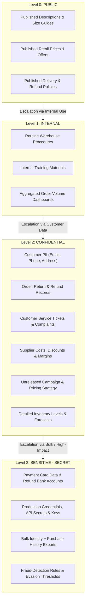
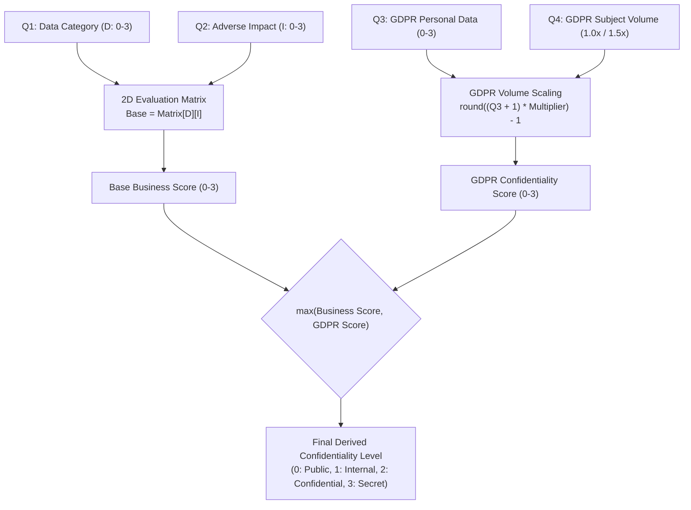

# Data Classification Policy & Guidance

> **Status**: Informative & Operational Reference Guide  
> **Target Audience**: Application Owners, Data Stewards, Security Auditors, Compliance Teams, DevSecOps Engineers  
> **Framework Alignment**: ISO/IEC 27001:2022 (A.5.12, A.5.13), NIST SP 800-53 (SC-13, MP-2), GDPR (Art. 32), PCI-DSS v4.0  
> **CISO Assistant Integration**: Linked to requirement node `data_classification` (`urn:intuitem:risk:req_node:appsec:data_classification`, `urn:intuitem:risk:req_node:appsec_manual:data_classification`, `urn:intuitem:risk:req_node:mls:data_classification`)

---

## 1. Overview & Objectives

Information is one of the organization's most critical assets. This document establishes standard classification levels, governance responsibilities, and illustrative data type examples across both general business operations and online-retail environments.

Accurate data classification directly dictates:
- **Baseline Technical Safeguards**: Encryption requirements (at-rest and in-transit), secret storage mechanisms, and key management.
- **Access & Identity Governance**: RBAC enforcement, privileged access management (PAM), and mandatory multi-factor authentication (MFA).
- **Audit Implementation Groups**: Automatic or manual scoping of high-assurance assessment tracks (e.g. `confidential_app`, `secret_app`).
- **Risk Scenario Impact Evaluation**: Scoring of confidentiality breach severity across threat scenarios in CISO Assistant.

---

## 2. Core Governance Principles

### 2.1 Role of Data Owners
- **Mandatory Confirmation**: Data owners are accountable for explicitly validating and confirming the assigned classification level for each dataset and application.
- **Dynamic Risk Reviews**: Data classification is not static. Data owners must review and adjust classification levels whenever operational contexts change, new integration pipelines are introduced, or business risks evolve.

### 2.2 Public Disclosure Authorization
> [!IMPORTANT]
> **Explicit Authorization Required**: Information is classified as **PUBLIC** only if it has received explicit formal approval for general publication by authorized corporate communications, legal, or executive leadership. Unapproved internal drafts or unverified data remain at minimum **INTERNAL** or **CONFIDENTIAL**.

### 2.3 Dataset Aggregation & Compilation Principle
> [!WARNING]
> **Dataset Aggregation Escalation**: Combining multiple low-sensitivity datasets often produces a high-sensitivity dataset. For example, while anonymized order volumes are **INTERNAL**, aggregating bulk order histories with customer identities, emails, and delivery addresses instantly escalates the classification to **CONFIDENTIAL** or **SENSITIVE - SECRET**.

---

## 3. Classification Levels & Impact Definitions

| Level | Classification Tag | Criticality Score | Description & Impact of Unauthorized Disclosure | Minimum Required Controls |
| :--- | :--- | :---: | :--- | :--- |
| **0** | **PUBLIC** | **0** | Information approved for public distribution. Unauthorized disclosure causes **zero organizational harm**. | Integrity controls, public CDN caching, web anti-defacement. |
| **1** | **INTERNAL** | **1** | Operational data intended strictly for internal workforce members. Unauthorized disclosure causes **minor operational friction**, internal confusion, or minor inconvenience. | Standard corporate authentication (SSO), internal network/VPN isolation, basic access logging. |
| **2** | **CONFIDENTIAL** | **2** | Sensitive business, customer, or employee data. Unauthorized disclosure causes **moderate to severe harm**, customer churn, regulatory penalties (GDPR fines), or competitive disadvantage. | Mandatory encryption in transit (TLS 1.2+) & at rest (AES-256), strict RBAC least privilege, audit logging, data masking in non-prod. |
| **3** | **SENSITIVE - SECRET** | **3** | Critical enterprise assets, cryptographic keys, root credentials, payment cardholder data (PCI-DSS), or government identifiers. Unauthorized disclosure causes **catastrophic or existential impact**, severe regulatory sanctions, major legal liabilities, or systemic financial compromise. | Hardware Security Modules (HSM) / KMS, zero-trust network segmentation, MFA for all access, real-time SIEM alerts, cryptographic data erasure. |

---

## 4. Master Data Classification Reference Matrix

The following table reflects core organizational examples alongside proposed online-retail operational starting points:

| Classification Level | Category | Data Type / Information Asset | Operational Context & Scope |
| :--- | :--- | :--- | :--- |
| **PUBLIC** | General Enterprise | Marketing materials | Public campaigns, promotional brochures, and published brand assets. |
| **PUBLIC** | General Enterprise | Press releases | Official corporate news announcements approved for release. |
| **PUBLIC** | General Enterprise | Third-party public internet info | Freely accessible public market reports and internet documentation. |
| **PUBLIC** | Online Retail | Published product descriptions, images & size guides | Customer-facing catalog data accessible on storefronts. |
| **PUBLIC** | Online Retail | Published retail prices & promotional offers | Active consumer prices, discounts, and advertised promotions. |
| **PUBLIC** | Online Retail | Published delivery, returns & refund policies | Public terms and conditions and customer fulfillment policies. |
| **INTERNAL** | General Enterprise | Sales figures | Internal revenue dashboards, non-strategic quarterly updates. |
| **INTERNAL** | General Enterprise | Organisational charts | Internal staff hierarchies, reporting lines, and team rosters. |
| **INTERNAL** | Online Retail | Routine warehouse operating procedures | Standard pick/pack/ship workflows excluding physical security details. |
| **INTERNAL** | Online Retail | Internal staff training materials | Operational onboarding content without customer or sensitive data. |
| **INTERNAL** | Online Retail | Routine aggregated order-volume dashboards | Metric dashboards lacking customer identifiers or strategic forecasts. |
| **CONFIDENTIAL** | General Enterprise | Supplier contracts | Negotiated vendor terms, Master Services Agreements (MSAs), NDAs. |
| **CONFIDENTIAL** | General Enterprise | Employee appraisals | Performance evaluations, salary discussions, and HR reviews. |
| **CONFIDENTIAL** | Online Retail | Customer PII (Names, emails, phones, delivery addresses) | Customer contact details and fulfillment shipping destinations. |
| **CONFIDENTIAL** | Online Retail | Customer order histories, return & refund records | Historical purchase logs, items bought, and return trackings. |
| **CONFIDENTIAL** | Online Retail | Customer-service conversations & complaint records | Support tickets, chat transcripts, and customer complaint records. |
| **CONFIDENTIAL** | Online Retail | Supplier purchase prices, negotiated discounts & margins | Wholesale costs, supplier trade secrets, and profit margin reports. |
| **CONFIDENTIAL** | Online Retail | Unreleased campaign plans & pricing strategies | Confidential future commercial calendar and unannounced sales strategies. |
| **CONFIDENTIAL** | Online Retail | Detailed inventory levels, forecasts & replenishment plans | Stock counts across fulfillment nodes, demand modeling, supply chain plans. |
| **SENSITIVE - SECRET** | General Enterprise | Payment data | Unmasked bank routing, primary account numbers, and transaction data. |
| **SENSITIVE - SECRET** | General Enterprise | Social security number (SSN) & national IDs | Government identification numbers, tax IDs, and sensitive PII. |
| **SENSITIVE - SECRET** | Online Retail | Customer payment-card data & refund bank accounts | Cardholder data environment (PCI-DSS PAN, CVV, expiry) & payout IBANs. |
| **SENSITIVE - SECRET** | Online Retail | Production admin credentials, API secrets & private keys | Cloud root keys, database master credentials, and TLS/signing keys. |
| **SENSITIVE - SECRET** | Online Retail | Bulk exports combining identity, address & purchase history | Comprehensive customer demographic and spending behavioral databases. |
| **SENSITIVE - SECRET** | Online Retail | Detailed fraud-detection rules & evasion thresholds | Anti-fraud model weights, risk scoring rules, and velocity triggers. |

---

## 5. Sector Deep-Dive: Online-Retail Data Governance

Online-retail applications handle multifaceted data streams combining high-volume web visitors with sensitive financial transactions and complex supply chains.

### 5.1 Proposed Classifications as Starting Points
> [!NOTE]
> Online-retail examples are **proposed starting points**, not rigid mandates. Data owners must validate each level against specific disclosure impacts, third-party vendor relationships, and jurisdictional laws (e.g. CCPA, GDPR, PCI-DSS).

### 5.2 Specific Handling Guidelines for Retail Data Types

#### 1. Fraud Detection Rules & Model Thresholds (SENSITIVE - SECRET)
- **Risk**: If exposed, sophisticated criminal networks can reverse-engineer rules to systematically bypass checkout defenses without triggering alerts.
- **Controls**: Store fraud algorithms in restricted repositories with role-based branch protections; mask threshold parameters in production monitoring logs.

#### 2. Bulk Data Exports (SENSITIVE - SECRET)
- **Risk**: An individual customer record is classified as `CONFIDENTIAL`. However, automated bulk extractions (e.g. data warehouse syncs, marketing CRM syncs) create an immense target for ransomware and data exfiltration.
- **Controls**: Enforce tokenized field-level encryption, multi-party authorization for batch exports, and short data retention lifecycles.

#### 3. Payment Card Data & Refund Accounts (SENSITIVE - SECRET)
- **Risk**: Direct financial theft, payment brand fines, loss of merchant processing agreement.
- **Controls**: Strict PCI-DSS v4.0 compliance. Tokenize PANs immediately via payment gateways; zero PAN/CVV retention in application databases; encrypt bank account numbers used for refund transfers.

---

## 6. Implementation in CISO Assistant Assessments

### 6.1 Multi-Question Narrowing Methodology
Instead of directly prompting users with an abstract single question (*"What is the maximum classification level?"*), which often leads to inaccurate self-reporting or subjective bias, the assessment breaks data classification down into **four objective, multi-dimensional questions** in the **Application Information & Governance** (`info`) chapter under requirement node **Data Classification** (`data_classification`):

1. **`q1`: Primary Retail & Operational Data Category**:
   - `c1` — Public storefront & published brand content (Published descriptions, retail prices, delivery/return policies).
   - `c2` — Internal operations, logistics & non-sensitive enterprise workflows (Warehouse SOPs, internal training, aggregated volume dashboards, org charts).
   - `c3` — Confidential commercial, supplier & customer operational records (Customer PII, order/refund histories, support tickets, supplier costs/margins, unreleased campaigns).
   - `c4` — Critical financial, cryptographic secrets, cardholder data & anti-fraud rules (Payment card data, refund bank accounts, admin/API keys, anti-fraud rules/thresholds).
2. **`q2`: Adverse Impact Severity of Unauthorized Disclosure**:
   - `c1` — Negligible / None (Information intended for public consumption; zero business or regulatory harm).
   - `c2` — Minor operational friction (Internal workforce inconvenience, minor productivity delay, no external breach).
   - `c3` — Moderate to severe harm (Customer trust damage, competitive disadvantage, financial penalties, GDPR notifications).
   - `c4` — Catastrophic or existential impact (Systemic financial fraud, payment gateway de-certification, major regulatory sanctions).
3. **`q3`: GDPR Personal Data Category**:
   - `c1` — No personal data processed.
   - `c2` — Contact data of employees (Workforce directories, internal emails).
   - `c3` — Contact and order details about customers (E-commerce buyers, delivery addresses, customer order histories).
   - `c4` — HR and financial details about employees and customer payment data (Payroll, banking details, cardholder data).
4. **`q4`: GDPR Data Subject Volume / Scale** (Conditional on `q3` being personal data):
   - `c1` — Low volume (< 1,000 individuals).
   - `c2` — Medium volume (1,000 to 100,000 individuals).
   - `c3` — High volume / Large-scale processing (> 100,000 individuals; triggers 1.5x impact multiplier).

### 6.2 Matrix & Cumulative Derivation Formula
The compliance engine (`classes/audits/compliance.py`) derives the final confidentiality criticality level and risk impact via a deterministic 2D matrix combining data category and adverse impact, reconciled with GDPR volume scaling:

#### Derivation Matrix ($D \times I$):
| Data Category ($D$) \ Adverse Impact ($I$) | $I=0$ (Negligible) | $I=1$ (Minor) | $I=2$ (Moderate/Severe) | $I=3$ (Catastrophic) |
| :--- | :---: | :---: | :---: | :---: |
| **$D=0$ (Public)** | 0 (Public) | 0 (Public) | 1 (Internal) | 2 (Confidential) |
| **$D=1$ (Internal)** | 0 (Public) | 1 (Internal) | 2 (Confidential) | 3 (Secret) |
| **$D=2$ (Confidential)** | 1 (Internal) | 2 (Confidential) | 2 (Confidential) | 3 (Secret) |
| **$D=3$ (Critical / Secret)** | 2 (Confidential) | 2 (Confidential) | 3 (Secret) | 3 (Secret) |

- **GDPR Harmonization**: The higher of the derived business classification score and the GDPR data score governs:
  $$\text{Final Confidentiality} = \max(\text{Derived Business Conf}, \text{GDPR Conf})$$

### 6.3 Impact on Risk Calculations
CISO Assistant maps this derived classification level (0-3) to the **Impact** score (1-4) of core threat scenarios:
- `unencrypted_data_in_transit` (Data exfiltration & unauthorized access)
- `unencrypted_data_at_rest` (Data store leakage)
- `sensitive_data_in_non_prod` (Exposure of staging/test environments)
- `missing_destruction_process` (Residual data recovery)

Applications handling `Secret` or `Confidential` data automatically escalate risk scenarios to High or Critical severity unless rigorous compensating technical controls are verified.

---

## 7. Document Revision & Review Cycle
- **Owner**: CISO & Enterprise Data Governance Office  
- **Review Frequency**: Annually or upon significant regulatory/business model changes  
- **Related Documents**: [AppSec Framework Improvement Plan](file:///home/python/ciso-assistant/docs/appsec_framework_improvement_plan.md), [AppSec Questions & Applicability Cases](file:///home/python/ciso-assistant/docs/appsec_questions_cases.md)

