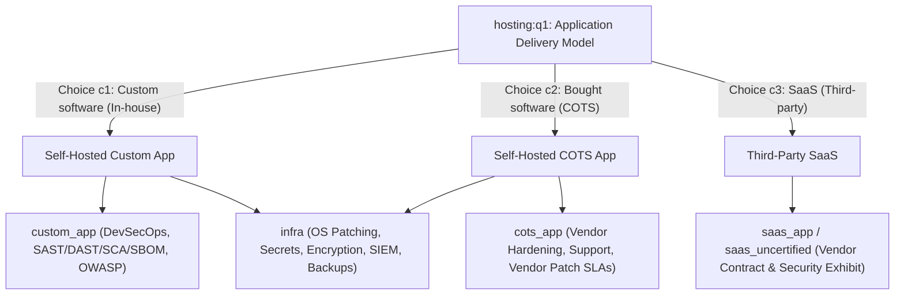

# TODO Next: Apply Infrastructure & OS Patching Track to Self-Hosted Apps (Custom & COTS)

**Date**: November 6, 2026  
**Status**: Ready for Implementation  
**Focus**: Ensure the `infra` track and OS Patching (`os_patching`) apply systematically to all self-hosted applications (both in-house **Custom** development and **COTS** vendor packages).

---

## 1. Problem Statement & Context

During application security evaluation of internal custom applications:
1. **OS Patching is Missing from Custom App Questionnaires**:
   - Internal custom applications deployed on company infrastructure are **self-hosted**, meaning operating system, container host, and kernel patch management are critical security requirements.
   - Currently, a respondent or auditor evaluating a custom internal application does not see any patch management question.

2. **Root Cause Analysis Across Frameworks**:
   - **`YML/appsec_manual.yml`**:
     - The node `os_patching` (*"Operating System Patching & High Availability"*, `q1`–`q3`) exists under `resilience_chapter`.
     - However, its scope is strictly `implementation_groups: ["infra"]`.
     - In `appsec_manual.yml`, tracks are assigned manually (`default_selected: false` for `infra`). If an auditor or user only assigns the `custom_app` track without explicitly adding `infra`, all infrastructure questions—including `os_patching`—remain hidden.
   - **`YML/appsec.yml` (Dynamic Variant)**:
     - The `infra` track was previously omitted entirely from `implementation_groups_definition`.
     - In `hosting:q1`, Choice `c1` (Custom) only auto-selects `["custom_app", "baseline"]`, and Choice `c2` (COTS) only auto-selects `["cots_app", "baseline"]`.
     - While other infrastructure nodes (`secrets_management`, `data_at_rest`, `security_event_logging`, `centralized_monitoring_and_alerting`, `backup_and_disaster_recovery`) were assigned to `["custom_app", "cots_app"]`, **`os_patching`** and **`data_in_transit`** were never ported into `appsec.yml`.
   - **`YML/appsec_objects.yml`**:
     - Scenario 21 (`os_and_host_unpatched_vulnerability`):
       - Likelihood points to `urn:intuitem:risk:req_node:appsec:os_patching`.
       - Currently restricted to `frameworks: ["appsec_manual"]` because `appsec.yml` lacks the requirement node.

---

## 2. Requirement & Architecture Goal

**Core Rule**:
> All **self-hosted applications**—whether created in-house (**Custom**) or purchased (**COTS**)—must be subject to the Infrastructure & Hosting Security Track (`infra`), including host/container **OS Patching (`os_patching`)**. Third-party **SaaS** applications remain excluded from `infra` (as the cloud provider operates the underlying infrastructure).



---

## 3. Detailed Action Items

### A. Update `YML/appsec.yml` (Dynamic Framework)

1. **Add `infra` to `implementation_groups_definition`**:
   ```yaml
   - urn: urn:intuitem:risk:ig:appsec:infra
     name: "Infrastructure & Hosting Security Track"
     ref_id: "infra"
     description: "Requirements for self-managed application hosting and infrastructure (OS patching, cryptography & secrets management, data encryption in transit/at rest, security event logging, SIEM forwarding, and backup/DR). Applicable to both custom and bought self-hosted apps; excluded for SaaS."
     default_selected: false
   ```

2. **Update `hosting:q1` Choice Triggers**:
   - Choice `c1` (*Custom software*):
     ```yaml
     select_implementation_groups: ["custom_app", "infra", "baseline"]
     ```
   - Choice `c2` (*Bought COTS software*):
     ```yaml
     select_implementation_groups: ["cots_app", "infra", "baseline"]
     ```
   - Choice `c3` (*SaaS*):
     ```yaml
     select_implementation_groups: ["saas_app", "baseline"]
     ```

3. **Port `os_patching` into `YML/appsec.yml`**:
   - Place under `parent_urn: urn:intuitem:risk:req_node:appsec:resilience_chapter`.
   - `ref_id: os_patching`
   - `implementation_groups: ["infra"]`
   - Include all 3 questions:
     - `os_patching:q1`: Automated OS patching within SLAs (Critical <= 14d, High <= 30d).
     - `os_patching:q2`: Documented patching schedule compliant with SLAs if not automatic.
     - `os_patching:q3`: Zero-downtime architecture (rolling updates, HA clusters, blue-green).
   - Link reference controls:
     - `urn:intuitem:risk:control:appsec:regular_penetration_testing`
     - `urn:intuitem:risk:control:appsec:backup_and_disaster_recovery`
   - Link vulnerabilities:
     - `urn:intuitem:risk:vulnerability:appsec:untested_application_security`
     - `urn:intuitem:risk:vulnerability:appsec:inadequate_resilience_backup`

4. **Align Self-Hosted Infrastructure Nodes in `YML/appsec.yml`**:
   - Assign the following nodes to `implementation_groups: ["infra"]` (or `["infra", "custom_app", "cots_app"]` for backward compatibility):
     - `secrets_management`
     - `data_at_rest`
     - `security_event_logging`
     - `centralized_monitoring_and_alerting`
     - `backup_and_disaster_recovery`
     - `os_patching`
   - (Optional) Port `data_in_transit` to `appsec.yml` under `crypto_chapter` with `implementation_groups: ["infra"]`.

5. **Increment Version**:
   - Increment `version` in `YML/appsec.yml`.

---

### B. Update `YML/appsec_manual.yml` (Manual Framework)

1. **Verify Implementation Groups & Dependencies**:
   - Ensure `implementation_groups_dependencies` triggers `infra` for both:
     - `hosting:q1:c1` (Custom software) -> triggers `custom_app` + `infra`
     - `hosting:q1:c2` (COTS software) -> triggers `cots_app` + `infra`
   - Verify `os_patching` node is present under `resilience_chapter` with `implementation_groups: ["infra"]`.
   - Verify all 3 questions (`os_patching:q1`, `os_patching:q2`, `os_patching:q3`) are intact with correct scoring and choices.

2. **Increment Version**:
   - Increment `version` in `YML/appsec_manual.yml`.

---

### C. Update `YML/appsec_objects.yml` (Common Objects)

1. **Update Risk Scenario 21**:
   - In `urn:intuitem:risk:scenario:appsec:os_and_host_unpatched_vulnerability`:
     ```yaml
     frameworks: ["appsec", "appsec_manual"]
     ```
   - (Previously only listed `["appsec_manual"]`).

---

### D. Update Documentation

1. **`docs/appsec_policy_applicability_matrix.md`**:
   - Update the **Scoping & Responsibility Boundary** section:
     - Clarify that while centralized enterprise IT manages general corporate laptops/fleet, **self-hosted application environments (VMs, container hosts, Kubernetes nodes, OS layers) are subject to OS patching verification via the `infra` track** for both Custom in-house apps and COTS deployments.
   - Update applicability tables to show `os_patching` applying to `infra` (Custom + COTS).

2. **`docs/appsec_questions_cases.md`**:
   - Add `os_patching` entry (`q1`, `q2`, `q3`) under Chapter 8 (Resilience) with mapping to `infra`.

---

### E. Update & Run Automated Unit Tests

1. **`tests/test_yaml_integrity.py`**:
   - Update `appsec` requirements checks to verify `os_patching` exists in `appsec.yml`.
   - Verify that `os_patching` has 3 questions and correct implementation group (`infra`).
   - Verify `appsec_objects.yml` Scenario 21 links cleanly to both frameworks without missing node errors.

2. **`tests/test_implementation_groups.py`**:
   - Add/update test cases verifying that:
     - `hosting:q1:c1` (Custom) triggers both `custom_app` and `infra`.
     - `hosting:q1:c2` (COTS) triggers both `cots_app` and `infra`.
     - `hosting:q1:c3` (SaaS) does NOT trigger `infra`.

3. **Run Full Test Suite**:
   ```bash
   python3 -m unittest discover tests
   ```
   Ensure all tests pass with 0 errors.

---

## 4. Quick Reference: OS Patching Node Structure

```yaml
      # Requirement: Operating System Patching & High Availability Architecture
      - urn: urn:intuitem:risk:req_node:appsec:os_patching
        assessable: true
        depth: 2
        parent_urn: urn:intuitem:risk:req_node:appsec:resilience_chapter
        ref_id: os_patching
        name: "Operating System Patching & High Availability"
        description: "Maintain operating system and platform patch hygiene within defined SLAs, and ensure system architecture allows no-downtime patching from a business perspective."
        annotation: >
          Evaluates host-level operating system (OS) patch management, compliant scheduling, and zero-downtime architectural resilience:
          - Automated vs. Scheduled OS Patching: Systematic deployment of operating system security updates, kernel patches, and platform fixes.
            When automated patching is not implemented, an established patching schedule compliant with organizational remediation SLAs
            (e.g., Critical <= 14 days, High <= 30 days) must be enforced via documented maintenance procedures.
          - No-Downtime Patching Architecture: System architecture designed to allow maintenance, patching, and node reboots without impacting business operations or inducing service outages (e.g., redundant multi-node clusters behind load balancers, rolling updates, active-active high availability, blue-green deployment pipelines, or serverless infrastructure with built-in platform maintenance).
        typical_evidence: >
          - OS patch management policy and SLA adherence tracking reports
          - Approved recurring patch maintenance schedule and calendar
          - High Availability (HA) / deployment architecture diagram demonstrating multi-node redundancy and rolling update capabilities
          - Maintenance records or post-patch reports confirming zero business downtime during host update cycles
        vulnerabilities:
          - urn:intuitem:risk:vulnerability:appsec:untested_application_security
          - urn:intuitem:risk:vulnerability:appsec:inadequate_resilience_backup
        implementation_groups: ["infra"]
        reference_controls:
          - urn:intuitem:risk:control:appsec:regular_penetration_testing
          - urn:intuitem:risk:control:appsec:backup_and_disaster_recovery
        questions:
          urn:intuitem:risk:req_node:appsec:os_patching:q1:
            type: unique_choice
            text: "Are operating system (OS) security patches, kernel updates, and host/container security updates applied automatically within formal SLAs? (e.g. Critical <= 14 days, High <= 30 days)"
            choices:
              - urn: urn:intuitem:risk:req_node:appsec:os_patching:q1:c1
                value: "Yes - OS patching is automatic"
                add_score: 50
                compute_result: true
                color: "#33a745"
              - urn: urn:intuitem:risk:req_node:appsec:os_patching:q1:c2
                value: "No - OS patching is not automatic"
                add_score: 0
                compute_result: false
                color: "#fd7e14"
          urn:intuitem:risk:req_node:appsec:os_patching:q2:
            type: unique_choice
            text: "If OS patching is not automatic, is there a formal patching schedule compliant with requirements? (e.g. documented recurring maintenance windows adhering to Critical <= 14 days, High <= 30 days)"
            depends_on:
              question: urn:intuitem:risk:req_node:appsec:os_patching:q1
              answers: ["urn:intuitem:risk:req_node:appsec:os_patching:q1:c2"]
              condition: any
            choices:
              - urn: urn:intuitem:risk:req_node:appsec:os_patching:q2:c1
                value: "Yes"
                add_score: 50
                compute_result: true
                color: "#33a745"
              - urn: urn:intuitem:risk:req_node:appsec:os_patching:q2:c2
                value: "No"
                add_score: 0
                compute_result: false
                color: "#dc3545"
          urn:intuitem:risk:req_node:appsec:os_patching:q3:
            type: unique_choice
            text: "Does the application and infrastructure architecture allow no-downtime patching from a business perspective? (e.g., high-availability clusters, rolling updates, or blue-green deployments preventing business downtime during maintenance)"
            choices:
              - urn: urn:intuitem:risk:req_node:appsec:os_patching:q3:c1
                value: "Yes"
                add_score: 50
                compute_result: true
                color: "#33a745"
              - urn: urn:intuitem:risk:req_node:appsec:os_patching:q3:c2
                value: "No"
                add_score: 0
                compute_result: false
                color: "#dc3545"
```

---

## 4. Completed: Intra-Node Question Prerequisites & Dependency Gating

Following the multi-question topic review in `YML/appsec_manual.yml` and `YML/appsec.yml`:

1. **`cots_deployment_hardening:q3` depends on `cots_deployment_hardening:q2 == c1` (Vendor Patch SLA Prerequisites)**:
   - Configured `q3` with `depends_on` targeting `q2:c1` in both `YML/appsec.yml` and `YML/appsec_manual.yml`.
   - If EOL / unsupported (`q2 == c2`), `q3` is skipped.
2. **`access_control_and_rbac:q3` depends on `access_control_and_rbac:q1 == c1` (Entitlement Recertification Prerequisites)**:
   - Configured `q3` with `depends_on` targeting `q1:c1` in both `YML/appsec.yml` and `YML/appsec_manual.yml`.
   - If no roles or permissions defined (`q1 == c2`), `q3` is skipped.
3. **Multi-Question Controls Retained Independent**:
   - `security_event_logging:q2` (log data masking) and `stakeholder_identification:q1-q4` (parallel ownership/CMDB checks) intentionally remain independent.
4. **Test Data & Test Suites Updated**:
   - `test_data/app_appsec_vulnerable_legacy.yml` updated to omit `q3` when `q1` is `No`.
   - Added `test_appsec_intra_node_prerequisites` in `tests/test_yaml_integrity.py`. All 268 tests pass cleanly.

---

## 5. Completed: 6 Answered Examples for Automated AppSec (`appsec`)

1. **Database Migration to Latest `appsec` Framework**:
   - Replaced old Nov 5th database instance with latest `appsec` framework (`urn:intuitem:risk:framework:appsec`, v28) with dynamic choice-level implementation group triggering (`select_implementation_groups`).
2. **Generated 6 Application Profiles**:
   - `test_data/app_appsec_custom_internal.yml` (Case 1: Custom + Internal, 21 nodes, 15 scenarios)
   - `test_data/app_appsec_custom_internet.yml` (Case 2: Custom + Internet, 23 nodes, 17 scenarios)
   - `test_data/app_appsec_cots_internal.yml` (Case 3: COTS + Internal, 17 nodes, 13 scenarios)
   - `test_data/app_appsec_cots_internet.yml` (Case 4: COTS + Internet, 19 nodes, 15 scenarios)
   - `test_data/app_appsec_saas_certified.yml` (Case 5: SaaS + Certified, 12 nodes, 7 scenarios)
   - `test_data/app_appsec_saas_uncertified.yml` (Case 6: SaaS + Uncertified, 26 nodes, 10 scenarios)
3. **Live Instance Provisioning**:
   - All 6 applications provisioned in domain `Example Applications` at `https://localhost:8443` in fully answered states with evaluated risk scenarios and linked controls.
4. **Validation**:
   - 275 unit tests passing (`python3 -m unittest discover tests`).

